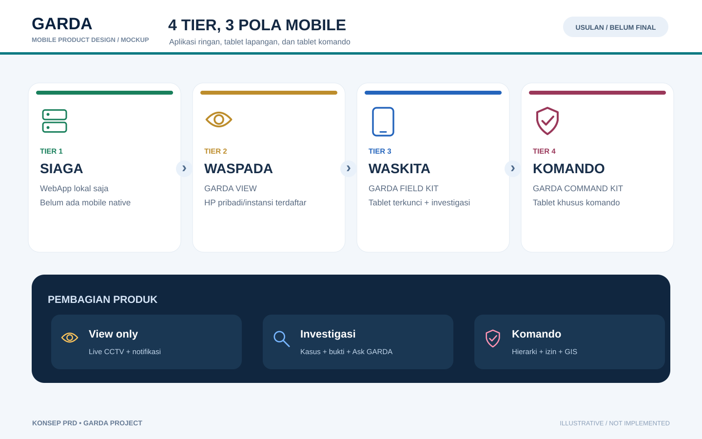
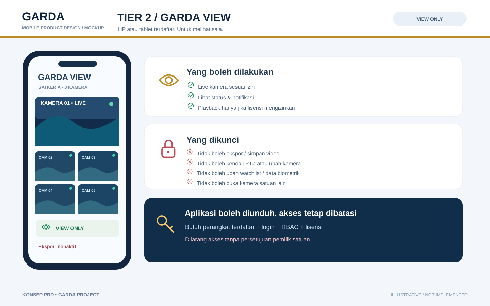
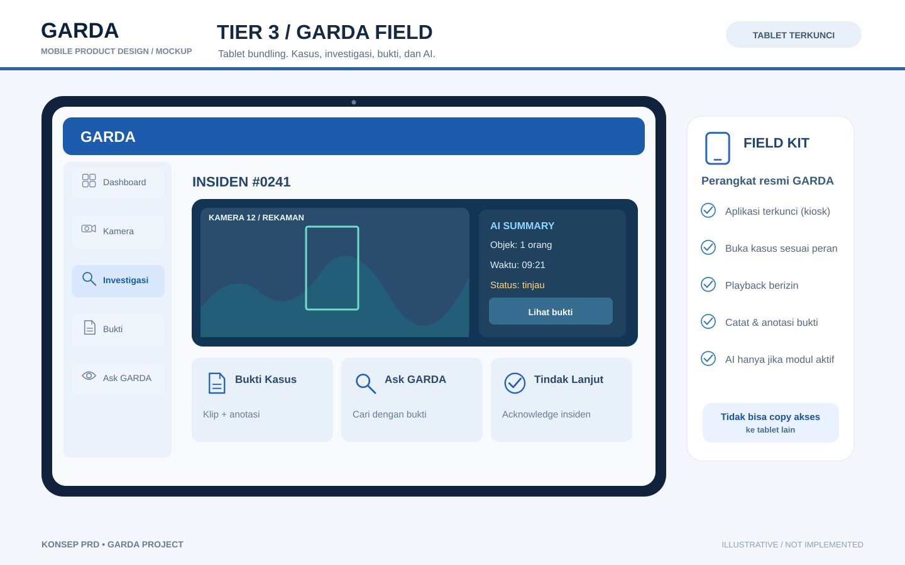
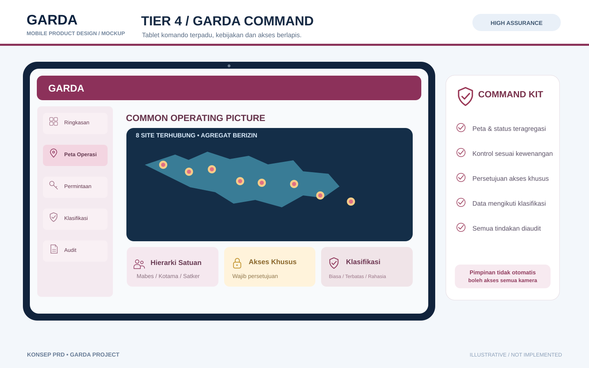
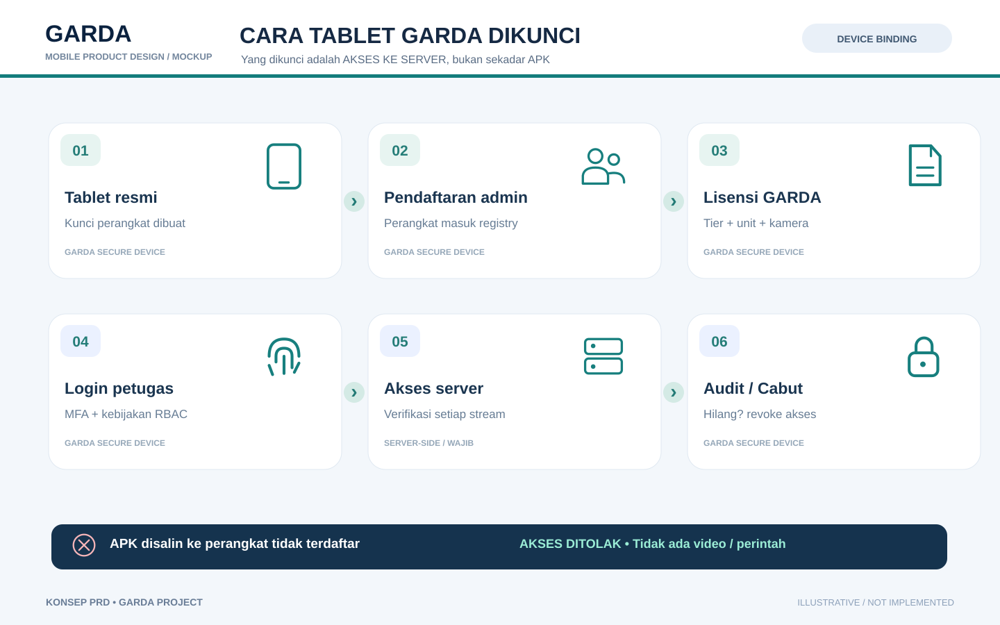
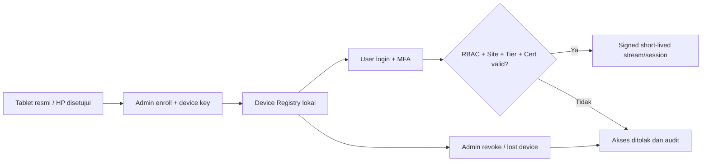
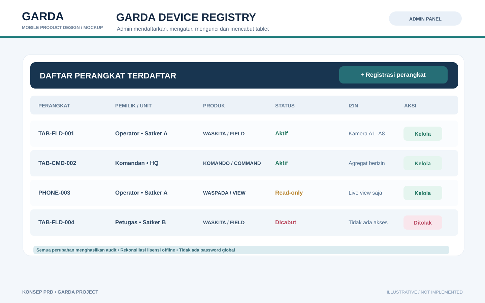

# PRD VISUAL GARDA MOBILE & SECURE TABLET v1.0 (DRAFT)
**Tanggal:** 08 Oktober 2026
**Status:** **USULAN UX/PRD, BELUM PERSETUJUAN PRODUK ATAU KONTRAK**
**Repo:** `adith92/GardaWEB` (private). Semua gambar adalah **mockup ilustratif**, bukan tangkapan layar aplikasi jadi.
**Konteks:** GARDA / PUSADA MONITORING CENTER; instansi pemerintah terutama TNI.

> **Ringkasnya:** Tier 1 **SIAGA** = WebApp lokal. Tier 2 **WASPADA** (usulan perubahan) = **GARDA VIEW** Android/iOS read-only untuk pengguna/perangkat berizin. Tier 3 **WASKITA** = **GARDA FIELD**, tablet bundling dengan sistem pengelolaan perangkat dan fungsi investigasi. Tier 4 **KOMANDO** = **GARDA COMMAND**, tablet bundling berhak komando yang tetap dibatasi kewenangan satuan, klasifikasi dan persetujuan.

## 1. Empat paket: cukup lihat gambarnya

| Tier | Nama produk mobile | Cara mendapat | Kemampuan | Yang TIDAK termasuk |
|---|---|---|---|---|
| **T1 SIAGA** | Belum ada mobile native | WebApp on-prem | 1 lokasi, sampai 49 channel, 1 operator aktif, CCTV + AI Basic sesuai PRD T1 | APK/iOS, lintas site, remote unmanaged |
| **T2 WASPADA** | **GARDA VIEW** (usulan) | Distribusi privat/terkendali hanya ke perangkat terdaftar | Live kamera milik satuan sendiri, status kamera, notifikasi yang diizinkan; playback hanya add-on | Download/ekspor bukti, PTZ, ubah watchlist, biometrik, kontrol fisik |
| **T3 WASKITA** | **GARDA FIELD KIT** | Tablet resmi perusahaan + app + lisensi perangkat + mode terkunci | Live, playback terotorisasi, kasus/insiden, anotasi bukti, Ask GARDA jika dilisensikan, investigation dashboard | Bebas lihat site lain, default ekspor file, kontrol command-center |
| **T4 KOMANDO** | **GARDA COMMAND KIT** | Tablet komando yang didaftarkan dan dikelola ketat | Ringkasan lintas tier, hierarki satuan, approval akses khusus, status klasifikasi, arahan/dispatch sesuai otorisasi | Akses kamera antarsatuan otomatis hanya karena jabatan; bypass klasifikasi |

**Penting:** pemilik sebelumnya mengarahkan seluruh aplikasi native mulai **T3**. Memasukkan **viewer native T2** adalah **REKOMENDASI PERUBAHAN**, belum disetujui; Codex **dilarang memperlakukannya sebagai scope final**. Nama SIAGA/WASPADA/WASKITA/KOMANDO pun belum dikunci sebagai merek final.

## 2. Tier 2 / GARDA VIEW: smartphone read-only

**Tujuan:** pimpinan atau petugas dapat mengamati CCTV milik unitnya tanpa harus memakai tablet operasi penuh. Aplikasi dapat dipasang di Android/iOS **hanya apabila perangkat mendapat enrollment dan izin server**. Customer TNI bisa mewajibkan *managed device* saja, tanpa BYOD.

**Layar usulan:**
1. **Aktivasi**: input kode undangan berumur pendek atau QR khusus provisioning; selesaikan registrasi dengan admin (QR bukan rahasia login).
2. **Login**: identitas, MFA sesuai kebijakan, informasi unit/site, device trust.
3. **Live Camera**: daftar kamera diizinkan, tampilan 1/4, indikator online, timestamp, watermark pengguna/perangkat.
4. **Notifikasi**: alarm dan status read-only; klik mengarah ke stream yang sudah diverifikasi.
5. **Akses Ditolak**: pesan singkat untuk kamera tidak berizin, device tak terdaftar, lisensi invalid, token habis atau revoke.

**Read-only secara nyata:** tidak cukup menyembunyikan tombol. Server perlu menolak API `evidence.export`, `camera.ptz`, `watchlist.manage`, `biometric.search`, `incident.command`, semua lintas-unit tanpa izin, serta pengunduhan media langsung. URL kamera mentah tidak boleh terlihat oleh client. Snapshot lokal/screenshots dibatasi jika platform memungkinkan, tetapi bukan pencegahan absolut.

**Tingkat izin:** viewer per user/site/camera; jumlah slot pengguna/perangkat dan apakah playback viewer diperbolehkan masih **OPEN**.

## 3. Tier 3 / GARDA FIELD KIT: tablet investigasi

**Produk fisik:** Tablet GARDA yang dipasok, disetel dan diinventaris oleh vendor; aplikasi GARDA Field sudah terpasang; mode kiosk/dedicated atau allowlist aplikasi yang disetujui admin; sertifikat unik per perangkat; prosedur penggantian barang.

**Layar usulan:** dashboard kasus, kamera & playback, rekaman per insiden, anotasi bukti, daftar tugas, Ask GARDA berbasis potongan bukti (hanya jika modul dilisensikan), laporan. Tidak boleh menggantikan video sumber dengan hasil AI yang dianggap fakta.

**Alur petugas contoh:** buka insiden → cek kamera/time → telaah hasil AI sebagai kandidat → verifikasi potongan video → tambahkan catatan/evidence → kirim review/eskalasi. Ekspor ke penyimpanan eksternal **mati secara default** dan membutuhkan izin eksplisit.

**Nilai bundling:** pengguna membeli sebuah **FIELD KIT**, bukan bebas menyalin APK ke tablet lain. Namun binary APK itu sendiri dapat diekstrak. Yang harus tak dapat ditiru secara praktis tanpa otorisasi adalah *akses layanan*, karena identitas perangkat, kredensial berbasis hardware, hak user, lisensi dan kebijakan seluruhnya diverifikasi server.

## 4. Tier 4 / GARDA COMMAND KIT: tablet komando

**Tujuan:** command center menggabungkan node T1–T4, tetapi tetap memisahkan tiap satuan. Hierarki contoh: Mabes → Kotama → Satker → Site, dapat dikonfigurasi mengikuti organisasi pelanggan.

**Layar usulan:** Common Operating Picture, peta operasional, status jumlah kamera/site online, antrean insiden, alur persetujuan lintas-satuan, klasifikasi (contoh Biasa/Terbatas/Rahasia), audit aktivitas komando, dispatch/operasi hanya bila modul dan SOP disetujui.

**Aturan:** pangkat/posisi HQ tidak otomatis membuka live view milik satuan lain. Permintaan khusus membutuhkan pemohon bernama, alasan/kasus, daftar aset, izin tindakan, persetujuan pihak yang ditunjuk, MFA dan grant/kode sekali pakai berumur pendek, pencabutan serta audit. Klasifikasi dan `need-to-know` harus tetap dilaksanakan server-side; kode khusus bukan pintu belakang.

## 5. Cara onboarding, penguncian dan revoke perangkat

**Kontrol wajib sebelum produk dinyatakan aman:**
- Kunci identitas perangkat dibuat di Android Keystore hardware-backed atau mekanisme iOS hardware-backed yang tersedia. Sertifikat perangkat dan revocation diperiksa di gateway lokal.
- `DeviceRegistry` menyimpan ID inventaris, sertifikat/kunci publik, owner unit, device status, tier, masa lisensi, audit dan tanggal pencabutan. Jangan menjadikan serial/IMEI sebagai rahasia autentikasi.
- `Session` harus berikat pada perangkat dan user; kamera/rekaman hanya melalui token pendek + pemeriksaan izin aktual, tanpa memberikan URL RTSP mentah.
- Konsep **MDM/kiosk** menghalangi pemasangan/penggunaan aplikasi lain pada tablet managed sesuai kemampuan OS. Perangkat hilang: revoke langsung di server; *remote wipe* baru berhasil bila tablet dapat dijangkau pengelola.
- **Offline-first:** server dapat bekerja tanpa internet; jika akses dari luar lokasi diperlukan, harus ada jaringan aman/VPN yang disetujui. Android/Apple cloud MDM dan attestation tidak otomatis jalan dalam lingkungan air-gapped; opsi MDM lokal perlu pembuktian terpisah.
- Anti-screen-capture/sideload hanya pengurangan risiko; tidak ada klaim mutlak bahwa APK tidak bisa disalin, tablet tak bisa direset, atau layar tidak bisa difoto.

## 6. Admin Console / Device Registry

**Modul admin minimal:** daftar perangkat, unit/site, tipe aplikasi, tier, hak kamera, status aktivasi, tanggal terakhir terhubung, masa lisensi, revoke, reissue untuk unit pengganti, log audit, ekspor inventaris tanpa kredensial rahasia.

**Contoh kasus kegagalan:** `TAB-FLD-004` dicabut, maka kamera/rekaman harus ditolak *meskipun* token atau APK sebelumnya tersimpan. Saat jaringan benar-benar terputus, sesi yang sudah terbit mungkin belum melihat revoke: atasi dengan sesi berumur pendek + kebijakan offline/masa kedaluwarsa yang jelas. Jangan menjanjikan revoke seketika di perangkat yang tidak dapat terhubung.

## 7. Kebutuhan fungsional untuk Codex
| ID | Prioritas usulan | Spesifikasi / acceptance |
|---|---|---|
| MOB-001 | P0 desain fondasi | Entitlement `tier, module, unit_id, site_id, allowed_camera_ids, seat, device_id` diverifikasi di backend |
| MOB-002 | P0 desain fondasi | Device Registry/Cert: enroll via admin, approve, revoke, reissue. Sertifikat unik, tanpa shared hardcoded password |
| MOB-003 | T2 kandidat | View-only mobile: hanya live kamera milik unit berizin dan notifikasi. Uji 403 ekspor, PTZ, watchlist, biometrik, cross-unit |
| MOB-004 | T2 kandidat | Login/MFA, device binding, offline/local network authorized and VPN security constraints |
| MOB-005 | T2 kandidat | Streaming mobile adaptif (session expiry, reconnect, bandwidth) tanpa mengganggu recorder/NVR |
| MOB-006 | T3 kandidat | Bundled tablet app + kiosk/MDM + inventaris + distributor/provisioning SOP |
| MOB-007 | T3 kandidat | Investigasi kasus, evidence timeline, video review/anotasi dan Ask GARDA bila entitlement aktif |
| MOB-008 | T3 kandidat | Pembatasan file ekspor, screenshot/cache, log & enkripsi at-rest serta policy perangkat hilang |
| MOB-009 | T4 kandidat | Federation summary dan unit hierarchy, ABAC klasifikasi, masa berlaku izin khusus |
| MOB-010 | T4 kandidat | Cross-unit request → approve → scoped grant → audit → revoke; hasil denial must be tested |
| MOB-011 | T4 kandidat | Command actions (radio/dispatch/access) hanya dengan human approval, interlock dan SOP |
| MOB-012 | Semua native kandidat | Bilingual ID/EN, accessibility, login/offline/error/denied states, manual user/admin/QA tests |

## 8. Data & API scaffolding (usulan, bukan implementasi)
- Entities: `ManagedDevice`, `DeviceEnrollment`, `UserSession`, `DeviceCertificate`, `MobileEntitlement`, `SiteAssignment`, `CameraGrant`, `VideoSession`, `AccessGrantRequest`, `AuditEvent`.
- Illustrative routes: `POST /v1/device-enrollments`, `POST /v1/device-attestations`, `GET /v1/me/entitlements`, `GET /v1/cameras?site_id=...`, `POST /v1/live-sessions`, `POST /v1/devices/{id}/revoke`, `POST /v1/access-grant-requests`. Final API and crypto reviewed separately.
- Backend is system of record for role, site, camera, tier and classification. UI hides unauthorized options for usability but server enforces all denials.
- Stream URLs are short-lived and scope-bound, logs do not include raw credentials or classified video.

## 9. Physical SKU / commercials still OPEN
| SKU sementara | Isi | Perlu dihitung / keputusan |
|---|---|---|
| VIEW LICENSE | Viewer app + per-user/per-device seat | T2 viewer **approved or not**, quota device, playback, BYOD policy |
| FIELD KIT | Tablet + case/charger + app + admin enrollment + MDM/kiosk + support | Tablet Android enterprise vs supervised iPad; offline MDM viability; one-app-only vs approved app allowlist |
| COMMAND KIT | Hardened tablet + app + command entitlement + strong enrollment | Authentication, classifications, accessories, deployment, RMA/spare, lifecycle, data network |
No pricing, model tablet, uptime or guaranteed capacity invented.

## 10. PUSADA first contract boundaries
Initial KAK must still be satisfied by **PUSADA special SIAGA + mandatory KAK modules**: camera points, 90-day retention and AI/security requirements per `GARDA_PUSADA_KAK_GAP_MATRIX_2026-10-08.md`. Mobile notifications may be required via agreed channel, but this does **NOT** automatically prove a native Android/iOS proprietary app or tablet bundle is required in this first contract. Proposal T2/T3/T4 is **roadmap** until signed.

## 11. Product decisions pending
1. Approve change: **native GARDA VIEW read-only begins Tier 2?** (supersedes earlier Tier3-only native app decision only if explicitly approved).
2. Tablet managed T3/4 **dedicated GARDA-only kiosk** versus allowlist application lain.
3. VIEW playback: pure live only vs playback read-only included?
4. T2 viewer on personal devices (BYOD) or **agency managed only**?
5. Device/licensing quotas, remote access topology, IT procurement & support obligations.
6. Which features, if any, are included as a PUSADA contract add-on.

## 12. Traceability
- Product owner context: `docs/GARDA_DECISION_REGISTER_v0.3.md`
- Mobile thesis: `docs/GARDA_MOBILE_TABLET_BUNDLING_PROPOSAL_v0.1.md`
- Prior source feature IDs: **VID-497–507**, **VID-536–548**, **VID-252–273**, **VID-297–308**; these must not be silently renumbered or re-tiered.
- All SVG artwork in `docs/mobile/assets/` is generated for planning; **NOT** certified deployment UI, NOT vendor/official TNI emblem.
