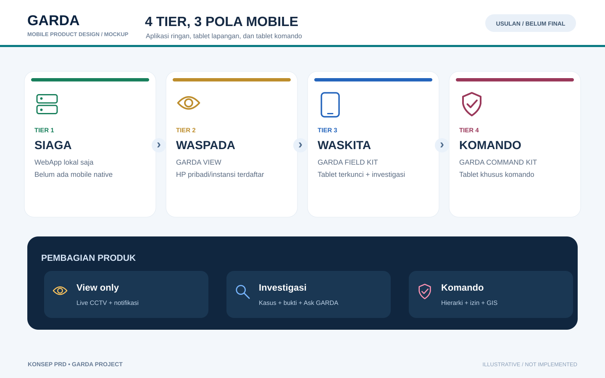
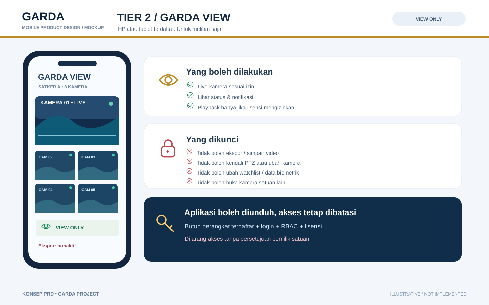
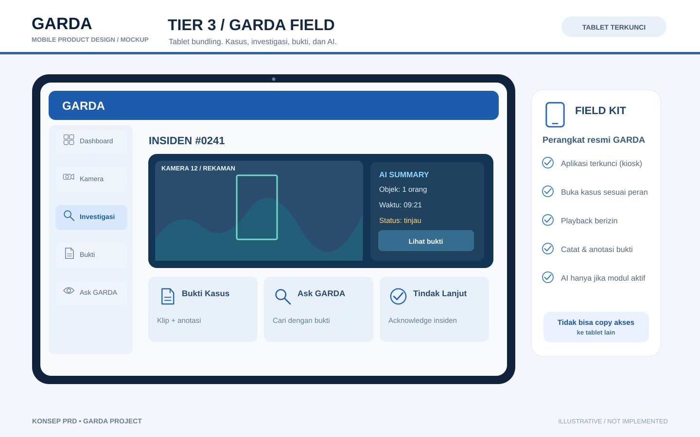
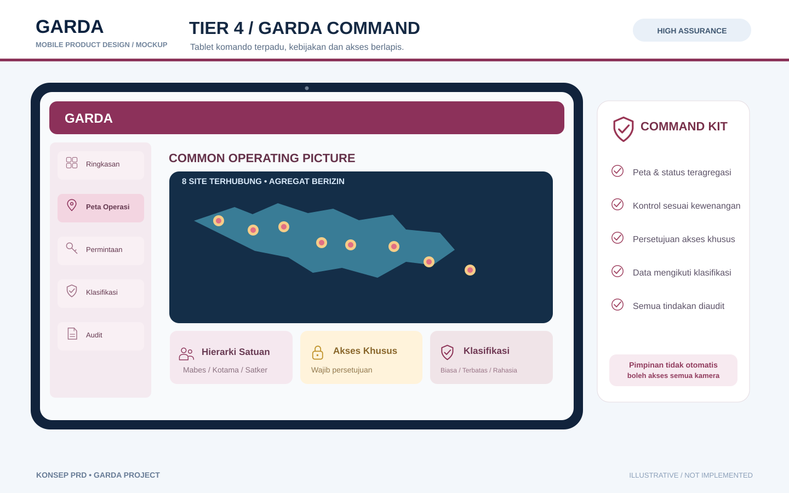
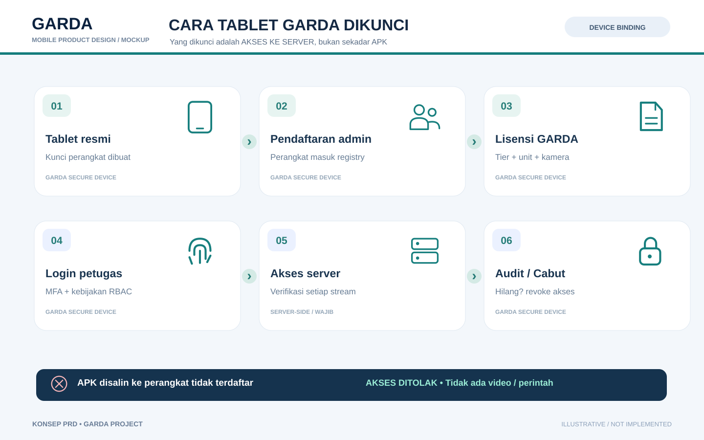
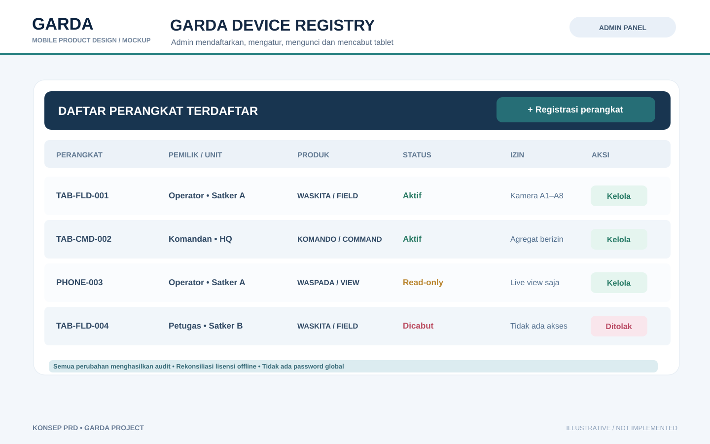

# GARDA MOBILE / TABLET — VISUAL INDEX

> **MOCKUP / PROPOSAL ONLY** · 08 Oktober 2026 · Not a deployed application or approved KAK deliverable.

## Mulai dari sini
**[Buka PRD visual untuk Codex](./PRD_GARDA_MOBILE_VISUAL_v1.0_DRAFT.md)**

### 1. Pembagian Tier Mobile

### 2. GARDA VIEW — Tier 2 (usulan)

### 3. GARDA FIELD KIT — Tier 3

### 4. GARDA COMMAND KIT — Tier 4

### 5. Cara perangkat dikunci

### 6. Pengelolaan tablet dan izin

## Jangan salah baca
- **Tier1** tetap WebApp, bukan native mobile.
- **Tier2 viewer** adalah **change request** karena keputusan terdahulu memulai native mobile di Tier3. Belum owner-approved.
- Tablet **Tier3/4** adalah managed device bundling. APK disalin ≠ mendapat akses, karena verifikasi dilakukan oleh backend.
- Gambar adalah rancangan konsep. Semua angka kamera, tier, klasifikasi, lisensi, model tablet dan keamanan harus mengikuti PRD, KAK, pengujian dan persetujuan.
- Sketsa tidak memberikan hak akses lintas-satuan dan bukan bukti fitur sudah dibangun.
